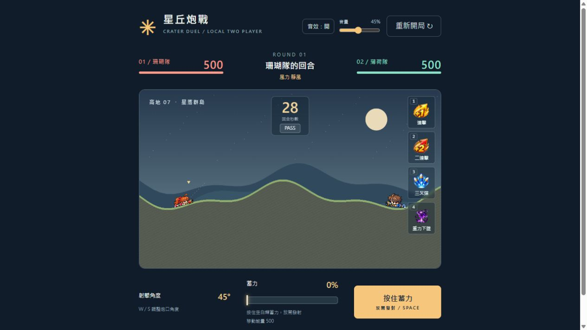

# 星丘炮戰｜CRATER DUEL

彈彈堂風格的本機雙人 2D 拋射遊戲。兩位玩家共用鍵盤，利用角度、力度、風向與可疊加道具，炸開地形並擊敗對手。

使用原生 JavaScript、Canvas 與 Web Audio，不需要安裝額外套件。本專案也保留從 Python 拋體公式、迴圈與 Tkinter 開始的[第四天課堂練習](practice/day04/README.md)。



## 啟動遊戲

需要 Node.js 18 以上。

```sh
git clone https://github.com/PerfectScholar/crater-duel-ai-practice.git
cd crater-duel-ai-practice
npm start
```

開啟 [http://127.0.0.1:4173](http://127.0.0.1:4173) 即可遊玩。這是本機雙人遊戲，目前沒有線上對戰。

## 操作方式

| 操作 | 按鍵／介面 |
| --- | --- |
| 左右移動 | A／D，每回合 500 移動能量，放開立即停止 |
| 抬高／壓低炮口 | W／S，兩隊依面向鏡像調角 |
| 蓄力與發射 | 按住空白鍵蓄力，放開發射；也可使用畫面蓄力按鈕 |
| 選擇道具 | 數字鍵 1～4，或右上角道具圖標；支援數字鍵盤 |
| 重力下墜 | 預先選用後，在炮彈飛行中再次按空白鍵 |
| 跳過回合 | 倒數下方的 PASS |
| 音效設定 | 右上角音效開關與音量拉桿 |
| 重新開始 | 右上角「重新開局」 |

蓄力條在 1.5 秒內從 0% 升至 100%，再於 1.5 秒內退回 0%。回退時仍可放開發射；退回起點仍未放開，會放棄該回合。蓄力時不能移動、調角或追加道具。切換視窗或分頁會中斷蓄力並放棄該回合；背景分頁暫停遊戲，返回時不補算離開的時間。

## 對戰規則

- 每位玩家初始 **500 HP**。血量歸零或掉出地圖底部即敗，雙方同時死亡為平手。
- 每回合 30 秒；最後 10 秒倒數會放大並變紅，時間到或按 PASS 就換人。
- 一輪所有炮彈結束、角色落穩後才換回合與結算勝負。
- 炮彈受正常重力與每回合風力影響。傷害依水平長橢圓範圍衰減，中心最大傷害為 62。
- 爆炸挖坑為**水平較寬、垂直較淺的橢圓**，水平半徑 58、垂直半徑 32；傷害範圍半徑為水平 94、垂直 52。
- 移動沒有水平慣性，高牆與陡峭坑壁仍會阻擋，沒有跳躍。

目前初速度設定為最低 20、滿蓄力 1150 像素／秒，曲線 γ 為 1。可在 `core/game.js` 的 `SHOT_CONFIG` 調整。血量與爆炸範圍分別集中於 `MAX_HP`、`EXPLOSION_CONFIG`；測試用速度拉桿與角度拉桿預設隱藏。

## 可疊加道具

道具位於遊戲畫面右上角，從上到下排列。預設是普通彈，不另外顯示；每種道具每回合可使用一次，選用後不可撤回，換回合重置。啟用時圖標會從角色身上升起、放大，並在頭上閃爍後消失。

| 快捷鍵 | 道具 | 效果 |
| --- | --- | --- |
| 1 | 連擊 +1 | 在原有基礎上增加一輪發射 |
| 2 | 二連擊 +2 | 在原有基礎上增加兩輪發射 |
| 3 | 三叉彈 | 每輪同時射出 -9°、原角度、+9° 三顆炮彈 |
| 4 | 重力下墜 | 飛行中再次按空白鍵，讓當下仍在空中的炮彈改為垂直向下 |

連擊的各輪間隔為 0.55 秒。+1、+2、三叉彈一起使用時，共四輪、每輪三顆，總計 12 顆。

重力下墜保留觸發瞬間的速度大小，只把方向轉為向下：`speed = Math.hypot(vx, vy)`、`vx = 0`、`vy = speed`。觸發後鎖定 X、不再受風力影響，重力與命中效果保持原樣。每次發射只能成功觸發一次；尚未射出的連擊炮彈仍沿用原本彈道。詳見[重力下墜說明](GRAVITY-DROP.md)。

## 角色與音效

兩位角色各有 8 幀循環爬行及 8 幀起身、抬炮、發射後座、回到趴姿的動作。爬行按 A／D 以固定幀率播放，不依賴著地判斷；移動能量用盡即停止。受傷時會閃爍與震動。

角色依附近地形傾斜，最大 ±25°，並以接觸容差與角度、位置死區降低抖動。這些只影響顯示，不改變碰撞與炮彈生成位置。目前採完整角色逐格圖集，保留未來頭部、身體、武器的分層接口，並未宣稱已拆層。參數與素材紀錄見[角色動畫說明](CHARACTER-ANIMATION.md)。

炮戰音效以程式合成，包含蓄力、發射、低頻爆炸、道具、倒數、換回合與結束提示。第一次點擊頁面或按鍵後啟用聲音；切換視窗會停止播放，可隨時靜音及調音量。

## 驗證與專案結構

```sh
npm test
python -m compileall -q practice/day04
```

目前 51 項自動測試，涵蓋物理、地形、回合、道具疊加、重力下墜、角色動畫、抗抖與音效。詳細紀錄見[驗證紀錄](TEST-REPORT.md)。GitHub Actions 會執行 JavaScript 測試與 Python 語法檢查。

```text
core/                     遊戲規則、像素地形、道具與飛行效果
main.js                   UI、鍵盤與固定步長主迴圈
render.js                 戰場、炮彈與特效
character-*.js            動作圖集、動畫狀態、貼地與角色繪製
audio.js / sound-synth.js  Web Audio 控制與原創合成音效
assets/                   遊戲素材、圖集座標與素材紀錄
scripts/                  音效試聽檔輸出工具
tests/                    Node 內建測試
practice/day04/           Python 課堂練習
.github/workflows/        自動檢查
```

[模組規劃](PLAN.md)保留原始 MVP 設計及後續線上模式構想；目前行為以本 README 與實際程式碼為準。圖片包含使用者提供素材及 AI 輔助生成／去背結果，來源與處理方式見[素材說明](assets/ASSET-NOTES.md)。
