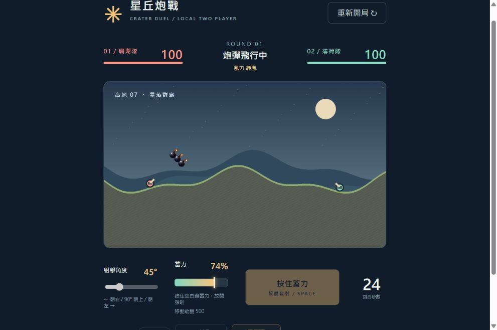

# 星丘炮戰｜AI 與 Python 第四天實作

從 Python 拋體公式、迴圈與 Tkinter，延伸到可破壞地形的本機雙人網頁遊戲。本 repo 同時保留遊戲成品與課堂練習，方便回顧我們怎麼把數學計算變成可操作的介面。

- **想玩遊戲**：依下方方式啟動星丘炮戰。
- **想看第四天在練習什麼**：閱讀 [第四天練習 README](practice/day04/README.md)，內含檔案導覽、公式、執行方式與待練習項目。
- **想看實作設計**：閱讀 [模組規劃](PLAN.md) 與 [測試紀錄](TEST-REPORT.md)。



## 星丘炮戰

本機雙人共用鍵盤，零套件 JavaScript / Canvas MVP。需要 Node.js 18 以上。

在此資料夾開啟終端，執行 `npm start`，開啟 http://127.0.0.1:4173 。`npm test` 執行核心自動驗收。

A / D 移動（每回合限 500 像素）；W 抬高炮口、S 壓低炮口（薄荷隊的數值增減方向與珊瑚隊相反）。按住空白鍵開始蓄力，放開立即發射；1.5 秒從左往右到 100%，再用 1.5 秒從右往左退回 0%。回退途中仍可發射；退回起點仍未放開，視為發射失敗並換人，不產生炮彈。也可按住畫面的蓄力按鈕，放開發射。蓄力中鎖定移動與角度。30 秒倒數結束直接換人；蓄力時切換視窗或分頁會中斷並放棄該回合。操作角度滑桿時方向鍵由瀏覽器控制該滑桿。炮彈受重力和每回合風力影響；爆炸挖洞並依距離扣血。血量歸零或掉出底部即敗，雙方同時死亡為平手。

詳細模組、資料流、里程碑、驗收與 Vue / WebSocket 擴充設計見 PLAN.md。目前不含線上模式、音效、跨機同步或原作素材。移動採圓形碰撞與每小步最多 3 像素的地面爬坡；高牆與陡峭坑壁仍會擋路，沒有跳躍。背景分頁時暫停，返回時不補算離開的時間。

## 射擊道具

蓄力前在底部選擇本回合道具，每回合只能選一種，不限制使用次數，換手後恢復普通彈。+2 連發：同一次蓄力依相同起點、角度、力度發射三顆，間隔 0.55 秒。三叉彈：同時射出中間、角度 -9°、+9° 三顆。每顆沿用普通彈的挖洞與傷害規則，待全部炮彈結束與角色落穩才換手；勝負也等整輪炮彈結束後結算。

## 專案結構

```text
core/                遊戲規則、像素地形與物理
render.js            Canvas 畫面與炸彈素材
main.js              UI、鍵盤與固定步長主迴圈
assets/              遊戲使用的透明炸彈與素材說明
tests/               21 項核心自動測試
practice/day04/      第四天 Python 原始練習與整理說明
.github/workflows/   GitHub 自動檢查
```

網頁遊戲使用原生 JavaScript / Canvas；Vue 3 UI 與 Node.js WebSocket 多人模式保留為後續擴充，目前沒有實作線上對戰。測試指令為 `npm test`。Python 語法檢查可執行 `python -m compileall -q practice/day04`；GUI 須在有桌面環境的本機執行。
